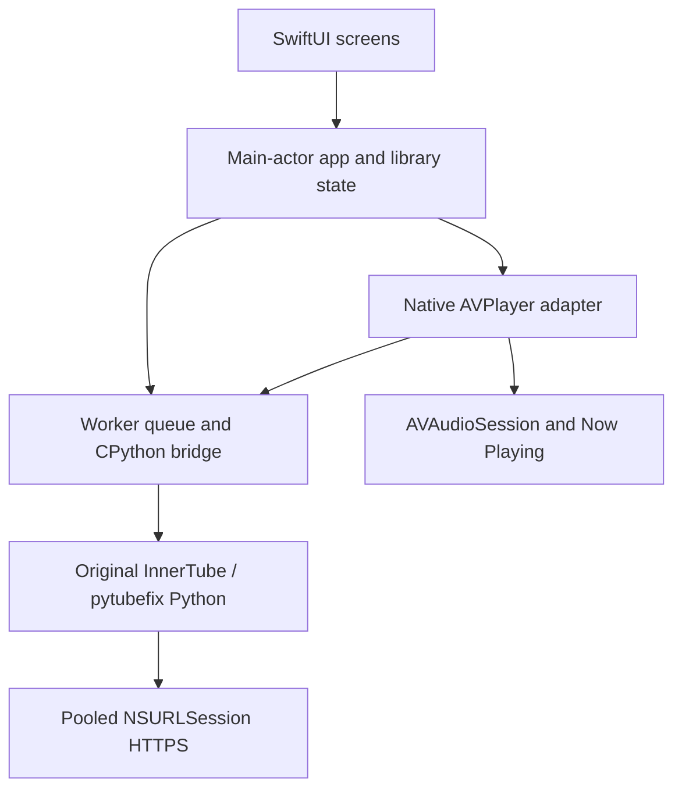

# iOS adaptation architecture

## Threading and cancellation

The interpreter initializes once on a worker, not the UI thread. A two-worker queue bounds catalog/source tasks. The Objective-C bridge holds the GIL for Python operations and releases it while native HTTPS waits. A shared ephemeral NSURLSession pools up to four connections per API host; its two-worker delegate queue checks incoming responses against a 4 MiB cap. Individual API requests have 7/8 second network deadlines and a 9 second native wait bound. Requests cannot redirect to a different host. Normal Apple TLS trust is retained.

Swift tasks forward cancellation to the native request token registry. A player generation UUID rejects stale song responses. `AVPlayer.timeControlStatus` determines the visible playing/buffering state; an animation cannot force a “playing” flag. A stalled item permits one fresh-source recovery, retaining its position when possible, then reports a readable failure. No infinite provider retry chain is added.

The Python backend contains its existing InnerTube-first and low-level pytubefix API path. Its source bytes are unchanged. `ios_api.py` attaches the native transport at runtime and normalizes catalog/format data for Swift. This boundary is new code and does not pretend Android Java, Media3 or Kotlin can run on iOS.

## Source quality

AVFoundation receives direct AAC/MP4 or HLS sources; Android’s WebM/Opus decoding path is not assumed to work across the iOS deployment range. Signed source URLs containing the unsupported `n` transform, non-HTTPS URLs, live sources and mismatched track metadata are rejected. Default-language audio is preferred. The selected bitrate is reported honestly. There is no upsampler or lossy-to-lossless conversion.

For iOS 16+, the public `AVURLAssetHTTPUserAgentKey` is used. iOS 15 uses Apple’s default media User-Agent; it must be verified physically. The undocumented `AVURLAssetHTTPHeaderFieldsKey` is not used. Provider URLs requiring additional headers or challenges may fail; availability is not guaranteed.

## Local audio and privacy

The document importer uses security-scoped access while checking `AVAudioFile.fileFormat`, then copies the original bytes into app-private storage. ALAC, FLAC and linear PCM are accepted; the decoded PCM processing format is not incorrectly used to label every compressed input lossless. Imports are bounded to 50 per picker result, 512 MiB each and 250 tracks, with a free-space reserve check. Local copies use complete-until-first-user-authentication file protection and are excluded from backup. Metadata stores relative filenames, not leaked security-scoped URLs.

Listening records, likes and followed artists are bounded and atomically saved in app-private storage. Playback failures are not logged as taste dislikes. This initial native taste ordering is intentionally documented as smaller than the original Kotlin algorithm, which remains in the reference tree for follow-up porting.

## Runtime packaging

The bundled upstream archive is `Python-3.13-iOS-support.b15.tar.gz`, SHA256 `80175765a31babe43b0910395cf86ba4e8412adf1902b069d55b74d523ecc5d1`. It contains ARM64 device and ARM64/x86_64 simulator frameworks. Build-time `install_python.py` copies common stdlib plus the active architecture’s extensions, relocates extension binaries into separate signed app frameworks, and emits CPython `.fwork` and `.origin` markers. Test/diagnostic modules are omitted from the built app. No binary code is downloaded after installation.

Dependencies under `SharedPython/packages` are pure Python and pinned by the Android baseline requirements. Bundled upstream licence files remain attached to those distributions. iOS compilation/signing and actual framework loading have not been executed in this Linux environment.
